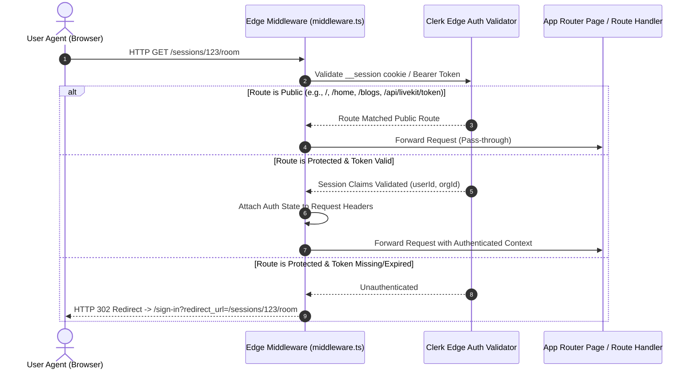
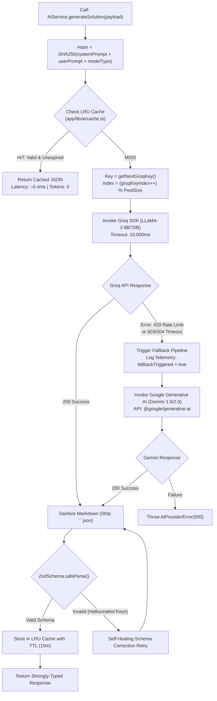
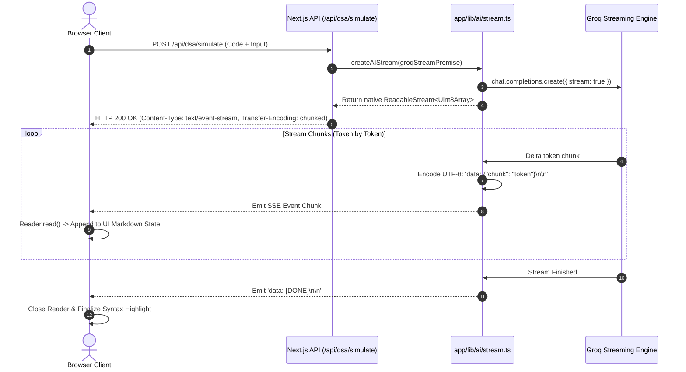
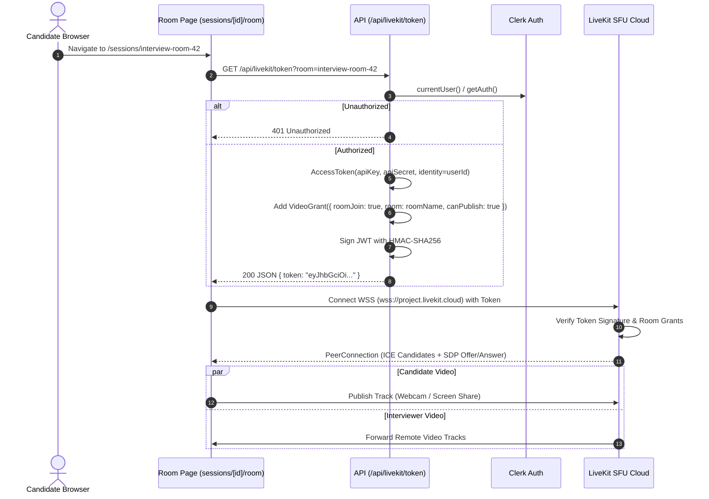
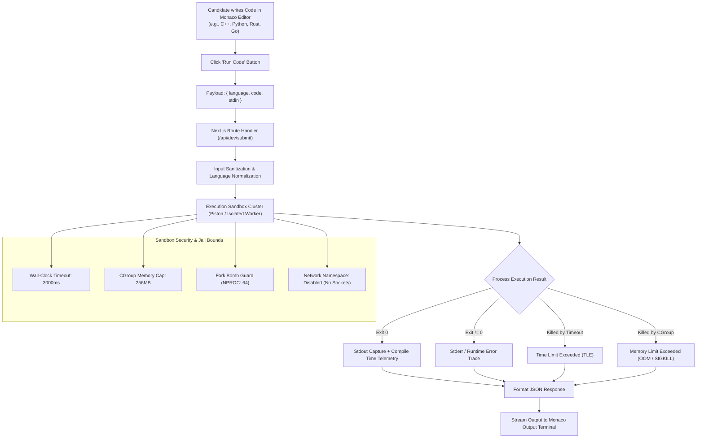

# CodeSaarthi: Enterprise Architecture & File-by-File Execution Blueprint 🏛️

> **Platform**: CodeSaarthi (v2.0)  
> **Engineering Scope**: Next.js 16 (App Router) · React 19 · Groq LPU Engine · Google Gemini AI · LiveKit WebRTC SFU · Prisma ORM · PostgreSQL (Supabase) · Clerk Edge Auth · Monaco Editor · Cloudinary CDN · GSAP & TailwindCSS v4.  
> **Author**: Saurabh Singh Rajput

---

## 1. System Topology & Global Request Architecture

The diagram below maps the end-to-end request lifecycle from edge DNS ingestion down to physical infrastructure and third-party AI/SFU clouds.

```mermaid
flowchart TD
    UserClient["Client Browser (React 19 / Monaco / LiveKit)"] -->|HTTPS / WSS| CloudflareEdge["Edge CDN & DNS Ingestion"]
    CloudflareEdge --> EdgeMW["Edge Middleware: middleware.ts (Clerk Auth Guard)"]
    
    EdgeMW -->|Public Route Allowed| PublicRoutes["Public Endpoints (/ , /home, /blogs)"]
    EdgeMW -->|Protected: Valid JWT| ProtectedRoutes["Protected Endpoints (/dsa, /sessions, /admin)"]
    EdgeMW -->|Protected: Invalid Session| AuthRedirect["302 Redirect to /sign-in"]

    ProtectedRoutes --> NextAppRouter["Next.js 16 App Router (Node.js Runtime)"]
    
    subgraph Compute & Logic Layer
        NextAppRouter --> API_AI["AI Gateway: /api/dsa/* & /api/gemini"]
        NextAppRouter --> API_WebRTC["WebRTC Token Service: /api/livekit/token"]
        NextAppRouter --> API_Data["Data API: /api/leaderboard & /api/contest"]
        NextAppRouter --> API_Media["Media API: /api/upload (Cloudinary)"]
    end

    subgraph AI Resilience Engine (app/lib/ai/*)
        API_AI --> LRUCache{"LRU Cache Check\n(SHA-256 Hash)"}
        LRUCache -->|Cache Hit < 1ms| CachedResp["Immediate Cached JSON"]
        LRUCache -->|Cache Miss| KeyPool["Round-Robin Key Selector\n(GROQ_API_KEY_POOL)"]
        
        KeyPool --> GroqCluster["Groq LPU Clusters (LLaMA-3.1-8B / 3.3-70B)"]
        GroqCluster -->|429 Rate Limit / 504 Timeout| GeminiFailover["Fallback Circuit: Google Gemini 1.5/2.0"]
        GroqCluster -->|200 OK Token Stream| SSEStream["SSE ReadableStream (stream.ts)"]
        GeminiFailover -->|200 OK| SSEStream
    end

    subgraph Real-Time Media (WebRTC)
        API_WebRTC --> LiveKitSDK["livekit-server-sdk (HMAC Signing)"]
        LiveKitSDK --> WebRTCToken["Signed LiveKit JWT"]
        WebRTCToken --> LiveKitCloud["LiveKit SFU (Selective Forwarding Unit)"]
    end

    subgraph Data Persistence & Pooler
        API_Data --> PrismaClientSingleton["Prisma Client Singleton (prisma.ts)"]
        PrismaClientSingleton --> SupabasePooler["Supavisor / PgBouncer Pooler (:6543)"]
        SupabasePooler --> PostgresDB[("PostgreSQL Database (Multi-AZ)")]
    end
```

---

## 2. Core Subsystems & Execution Workflows

### 2.1. Request Authentication & Route Guarding Pipeline
- **Primary Source File**: [`middleware.ts`](file:///c:/Users/DELL/codeify/middleware.ts)



#### Detailed Execution Mechanics
1. **Edge Execution**: `middleware.ts` runs inside Vercel Edge Runtime before any server components or route handlers are invoked, preventing compute costs on unauthorized traffic.
2. **Matcher Logic**: `createRouteMatcher` compiles regex patterns covering `/`, `/home`, `/blogs(.*)`, `/welcome`, and static assets.
3. **Session Rehydration**: Clerk injects `auth()` helper methods accessible downstream in server components and route handlers.

---

### 2.2. Multi-Key Round-Robin & Cross-Cloud AI Failover
- **Primary Source Files**:
  - [`app/lib/ai/provider.ts`](file:///c:/Users/DELL/codeify/app/lib/ai/provider.ts)
  - [`app/lib/ai/service.ts`](file:///c:/Users/DELL/codeify/app/lib/ai/service.ts)
  - [`app/lib/ai/cache.ts`](file:///c:/Users/DELL/codeify/app/lib/ai/cache.ts)
  - [`app/lib/ai/stream.ts`](file:///c:/Users/DELL/codeify/app/lib/ai/stream.ts)



#### Detailed Execution Mechanics
1. **Multi-Key Pool Parsing**: `getGroqKeyPool()` parses the `GROQ_API_KEY_POOL` environment string (comma-separated keys). If empty, it falls back to `GROQ_API_KEY`.
2. **Atomic Pointer Rotation**: `groqKeyIndex` increments in memory, evenly distributing TPM (tokens per minute) pressure across separate API quotas.
3. **Graceful Degradation**: If Groq returns HTTP 429 or times out past `timeoutMs: 10000`, the error is caught, and `callGemini()` is executed with normalized prompt structures.
4. **LRU Eviction**: `AICache` maintains doubly-linked node references. When node count exceeds `maxSize` (default 100), the tail node is purged.

---

### 2.3. Server-Sent Events (SSE) AI Streaming Pipeline
- **Primary Source Files**:
  - [`app/lib/ai/stream.ts`](file:///c:/Users/DELL/codeify/app/lib/ai/stream.ts)
  - [`app/lib/ai/client.ts`](file:///c:/Users/DELL/codeify/app/lib/ai/client.ts)



#### Detailed Execution Mechanics
1. **Chunked Transfer**: The response sends headers `Cache-Control: no-cache` and `Content-Type: text/event-stream`.
2. **Zero-Buffering**: Each token received from the LLM provider is instantly formatted with `data: ` and double newline separators (`\n\n`), preventing intermediate proxy buffers from stalling delivery.
3. **Client Stream Consumer**: `app/lib/ai/client.ts` wraps the browser `ReadableStreamDefaultReader`, parsing JSON payloads and handling network reconnects gracefully.

---

### 2.4. Real-Time WebRTC Video SFU Signaling
- **Primary Source Files**:
  - [`app/api/livekit/token/route.ts`](file:///c:/Users/DELL/codeify/app/api/livekit/token/route.ts)
  - [`app/sessions/[id]/room/page.tsx`](file:///c:/Users/DELL/codeify/app/sessions/%5Bid%5D/room/page.tsx)
  - [`app/components/VideoRoomWrapper.tsx`](file:///c:/Users/DELL/codeify/app/components/VideoRoomWrapper.tsx)



#### Detailed Execution Mechanics
1. **Zero Secret Leakage**: The browser never sees `LIVEKIT_API_SECRET`. Tokens are signed solely on the server.
2. **Selective Forwarding (SFU)**: Instead of peer-to-peer mesh where users stream directly to every other participant, media is routed via LiveKit's edge media servers. This ensures fixed $O(1)$ client upload bandwidth regardless of room participant count.
3. **Adaptive Bitrate (Simulcast)**: LiveKit publishes multiple spatial layers (high, medium, low). Subscribers dynamically receive lower resolution streams during bandwidth degradation without interrupting audio.

---

### 2.5. Isolated Multi-Language Code Execution Engine
- **Primary Source Files**:
  - [`app/home/page.tsx`](file:///c:/Users/DELL/codeify/app/home/page.tsx)
  - [`app/api/dev/submit/route.ts`](file:///c:/Users/DELL/codeify/app/api/dev/submit/route.ts)



#### Detailed Execution Mechanics
1. **Host Isolation**: Untrusted candidate code is never evaluated with `eval()` or executed natively on the Next.js server instance.
2. **Containerized Execution**: Code files are written into ephemeral scratch files inside temporary isolated namespaces with restricted Linux CGroups.
3. **Terminal Feedback**: Output distinguishes compilation failures (`stderr`) from standard execution logs (`stdout`) and execution metadata (execution duration in ms).

---

### 2.6. Database Persistence Layer: Connection Pooling & Index Scans
- **Primary Source Files**:
  - [`app/lib/prisma.ts`](file:///c:/Users/DELL/codeify/app/lib/prisma.ts)
  - [`prisma/schema.prisma`](file:///c:/Users/DELL/codeify/prisma/schema.prisma)
  - [`app/api/leaderboard/route.ts`](file:///c:/Users/DELL/codeify/app/api/leaderboard/route.ts)

```mermaid
flowchart TD
    subgraph Serverless Edge / Node Runtime
        Req1["API Route Instance 1"]
        Req2["API Route Instance 2"]
        ReqN["API Route Instance N..."]
    end

    subgraph Prisma Singleton Protection (app/lib/prisma.ts)
        Req1 --> ClientSingleton["globalForPrisma.prisma || new PrismaClient()"]
        Req2 --> ClientSingleton
        ReqN --> ClientSingleton
    end

    subgraph Supabase / Postgres Topology
        ClientSingleton -->|DATABASE_URL: Port 6543| Supavisor["Supavisor Connection Pooler\n(Transaction Mode: 1000s of Client Connections)"]
        Supavisor -->|5-10 Persistent DB Sockets| PostgresInstance[("PostgreSQL Physical Database\n(Max Allowed Connections: 60)")]
        
        DirectPrisma["Prisma Migrate (CLI)"] -->|DIRECT_URL: Port 5432| PostgresInstance
    end

    subgraph Query Optimization & B-Tree Indexing
        LeaderboardReq["Leaderboard Query:\nSELECT * FROM ContestAttempt\nORDER BY createdAt DESC LIMIT 50"]
        PostgresInstance --> LeaderboardReq
        LeaderboardReq --> IndexCheck{"Index @@index([createdAt]) exists?"}
        IndexCheck -- "YES" --> FastScan["B-Tree Leaf Scan: 3ms (Zero Seq Scan)"]
        IndexCheck -- "NO" --> SlowScan["Full Table Scan: 1200ms (High Disk I/O)"]
    end
```

#### Detailed Execution Mechanics
1. **HMR Connection Leak Prevention**: In `app/lib/prisma.ts`, `globalThis` is used to stash the `PrismaClient` instance during Next.js Hot Module Replacement, preventing socket exhaustion during development.
2. **Transaction Pooling vs Session**: Port 6543 runs transaction pooling, which releases database connections immediately after a transaction block completes, rather than holding it open for client life.
3. **Index Coverage**: `@@index([userId])` optimizes user history dashboards, while `@@index([createdAt])` eliminates sorting bottlenecks on global contest leaderboards.

---

## 3. Comprehensive File-by-File Technical Breakdown

| File Path | Subsystem | Responsibility | Critical APIs & Dependencies |
|---|---|---|---|
| [`middleware.ts`](file:///c:/Users/DELL/codeify/middleware.ts) | Edge Security | Intercepts all HTTP traffic, enforces authentication on protected routes, routes public traffic. | `@clerk/nextjs/server`, `createRouteMatcher` |
| [`app/lib/prisma.ts`](file:///c:/Users/DELL/codeify/app/lib/prisma.ts) | Persistence | Manages global singleton connection instance for Prisma ORM. | `@prisma/client`, `globalThis` |
| [`prisma/schema.prisma`](file:///c:/Users/DELL/codeify/prisma/schema.prisma) | Data Definition | Declares PostgreSQL schemas, relational indexes, and dual-URL connection pool routing. | PostgreSQL, Prisma Schema Engine |
| [`app/lib/ai/provider.ts`](file:///c:/Users/DELL/codeify/app/lib/ai/provider.ts) | AI Infrastructure | Multi-key round-robin pool, Groq LPU execution, error catching, automated Gemini fallback circuit. | `groq-sdk`, `@google/generative-ai` |
| [`app/lib/ai/service.ts`](file:///c:/Users/DELL/codeify/app/lib/ai/service.ts) | AI Logic | Prompt templating, markdown code fence cleansing, Zod JSON validation, self-healing retries. | `zod`, `crypto` |
| [`app/lib/ai/cache.ts`](file:///c:/Users/DELL/codeify/app/lib/ai/cache.ts) | AI Performance | In-memory LRU cache with SHA-256 prompt hashing and TTL expiration. | Node.js `crypto` |
| [`app/lib/ai/stream.ts`](file:///c:/Users/DELL/codeify/app/lib/ai/stream.ts) | AI Streaming | Transforms LLM async token streams into browser-compliant Server-Sent Events (SSE). | Web `ReadableStream`, `TextEncoder` |
| [`app/lib/ai/client.ts`](file:///c:/Users/DELL/codeify/app/lib/ai/client.ts) | AI Client | Client-side stream consumer; manages chunk decoding and incremental state updates. | Browser Streams API |
| [`app/api/livekit/token/route.ts`](file:///c:/Users/DELL/codeify/app/api/livekit/token/route.ts) | WebRTC Auth | Authenticates candidate session and issues signed JWT tokens for LiveKit video rooms. | `livekit-server-sdk`, `@clerk/nextjs` |
| [`app/sessions/[id]/room/page.tsx`](file:///c:/Users/DELL/codeify/app/sessions/%5Bid%5D/room/page.tsx) | Live Video Room | Full-screen interactive interview room with camera, screen share, and participant audio. | `@livekit/components-react`, `livekit-client` |
| [`app/home/page.tsx`](file:///c:/Users/DELL/codeify/app/home/page.tsx) | Code Studio | 11-Language playground with Monaco editor, standard I/O console, and language selector. | `@monaco-editor/react`, `use-debounce` |
| [`app/page.tsx`](file:///c:/Users/DELL/codeify/app/page.tsx) | Landing Page | High-conversion entry point; orchestrates GSAP scroll animations, showcase cards, and CTA flows. | `gsap`, `ScrollTrigger`, `@gsap/react` |
| [`app/components/MeetDeveloperSection.tsx`](file:///c:/Users/DELL/codeify/app/components/MeetDeveloperSection.tsx) | Portfolio / Showcase | Glassmorphic developer identity card detailing experience, open-source roles, and tech philosophy. | React 19, `lucide-react`, TailwindCSS v4 |
| [`app/globals.css`](file:///c:/Users/DELL/codeify/app/globals.css) | Design System | Defines CSS tokens, obsidian dark surfaces, GPU-accelerated glassmorphism, and keyframe animations. | TailwindCSS v4, CSS Custom Properties |

---

## 4. Key Engineering Architectural Principles

### 1. Zero-Trust AI Output Sanitization
LLMs non-deterministically prepend ````json` fences or append conversational prose even when `response_format: { type: "json_object" }` is specified. The platform implements a deterministic two-stage pipeline:
$$\text{Raw Tokens} \longrightarrow \text{RegEx Stripping} \longrightarrow \text{JSON.parse()} \longrightarrow \text{Zod Schema Validation}$$
Any deviation triggers self-healing error reflection prompts rather than surfacing UI crashes to candidates.

### 2. High-Density Concurrency in Serverless Environments
By deploying Supavisor transaction-mode connection pooling on port 6543, thousands of concurrent serverless invocations share a bounded pool of 10–15 physical PostgreSQL connections, completely eliminating the common `FATAL: remaining connection slots are reserved for non-replication superuser connections` error.

### 3. GPU-Composited 60 FPS Interface
All animated glassmorphism cards leverage `backdrop-filter: blur()`, `will-change: transform`, and hardware-accelerated 3D transforms (`translate3d(0,0,0)`). This forces browser engines (Chromium/WebKit) to offload layout operations directly to the GPU compositor thread, guaranteeing sustained 60 FPS scroll performance without layout thrashing.
